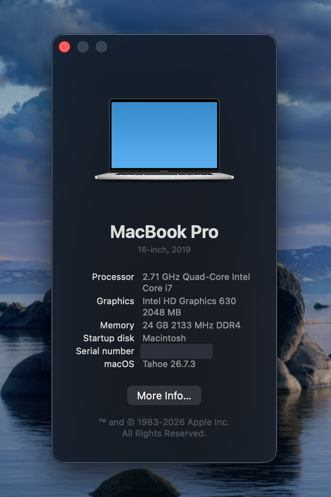
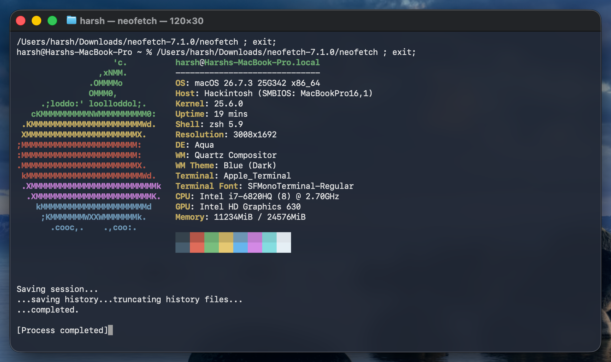

# Dell Precision 5510 — OpenCore EFI for macOS Tahoe 26

OpenCore 1.0.8 EFI for the **Dell Precision 5510** (i7-6820HQ, Skylake). It boots **macOS Tahoe 26.7.3** and also boots **macOS Sequoia 15** from the same EFI.

<p align="center">
  
  &nbsp;&nbsp;
  
</p>

> [!WARNING]
> **Generate your own SMBIOS before you boot this EFI.**
> The serial number, MLB, UUID and ROM in `config.plist` are placeholders. See [SMBIOS](#smbios).

---

## Hardware

| Component | Model | Status in macOS |
|---|---|---|
| CPU | Intel Core i7-6820HQ (Skylake, 4C/8T) | ✅ Native power management (CPUFriend + `SSDT-PLUG`) |
| iGPU | Intel HD Graphics 530 | ✅ Spoofed as HD 630 (Kaby Lake), full Metal acceleration |
| dGPU | NVIDIA Quadro M1000M | ⛔ Disabled (`SSDT-DGPU`), not supported by macOS |
| Wi-Fi / Bluetooth | Intel Dual Band Wireless-AC 8260 | ✅ Wi-Fi (AirportItlwm) · Bluetooth not yet verified on Tahoe |
| Audio | Realtek ALC3266 (ALC298) | ✅ Speakers and headphone jack (AppleALC + SimpleHDA on Tahoe) |
| Touchpad | I2C HID | VoodooI2C + VoodooI2CHID |
| Keyboard | PS/2 | VoodooPS2Controller |
| Card reader | Realtek PCIe | Sinetek-rtsx |
| Storage | NVMe | ✅ NVMeFix |
| Display | Internal 4K UHD (3840×2160) | ✅ See [Known issues](#known-issues) for scaled-mode flicker |

## Software

| | |
|---|---|
| Bootloader | OpenCore **1.0.8** (RELEASE) |
| Tested macOS | **Tahoe 26.7.3 (25G342)**, Sequoia 15 (dual boot) |
| SMBIOS | `MacBookPro16,1` (supported by Tahoe) |
| SIP | `csr-active-config` = `03080000` (needed for Sequoia's OCLP Wi-Fi patch) |
| SecureBootModel | `Disabled` |

## Status

### Working on Tahoe
- **Boot:** boots Tahoe and Sequoia from the same EFI.
- **Graphics:** full acceleration as HD 630, 2048 MB VRAM, Metal.
- **Wi-Fi:** native Tahoe AirportItlwm, **no OCLP root patch needed**.
- **Audio:** speakers and headphone jack.
- **Boot experience:** clean, with no verbose text or OpenCore logging.

### Not working / not supported
- **NVIDIA Quadro M1000M:** disabled. macOS has no driver for it.
- **AirDrop / AWDL:** not supported by AirportItlwm on Intel cards.
- **WPA3-only Wi-Fi networks:** not supported by the Tahoe AirportItlwm alpha.

### Not yet verified on Tahoe
- Bluetooth
- Sleep / wake
- Every USB port
- Touchpad gestures
- Card reader
- External displays over HDMI or USB-C

## Known issues

1. **Kernel panic on restart (Tahoe).** Choosing *Restart* panics and the machine has to be powered off by hand. Under investigation.
   - Suspects are the Tahoe-only kexts: AirportItlwm 2.4.0-alpha, SimpleHDA, IntelBTPatcher 2.5.3.
   - If you hit this, panic reports in `/Library/Logs/DiagnosticReports/*panic*` are welcome as issues.
2. **Flicker in scaled 4K modes** ("More Space", e.g. *looks like* 2560×1440). This started with Ventura and comes from running the Kaby Lake driver on Skylake hardware. Windows and Monterey with the native Skylake driver don't flicker.
   - **Workaround:** use the default *looks like 1920×1080*, or 2048×1152.

## Before you use it

1. Generate your own SMBIOS (see below).
2. Use the usual Dortania Skylake laptop BIOS settings. See the [Dortania Skylake laptop guide](https://dortania.github.io/OpenCore-Install-Guide/config-laptop.plist/skylake.html).
3. Test from a USB stick first: copy `EFI/` to the root of the USB's EFI partition.

### SMBIOS

Generate a `MacBookPro16,1` serial with [GenSMBIOS](https://github.com/corpnewt/GenSMBIOS) or OCAT. Then fill in these keys under `PlatformInfo → Generic`:

| Key | Placeholder in this repo |
|---|---|
| `SystemSerialNumber` | `W00000000001` |
| `MLB` | `M0000000000000001` |
| `SystemUUID` | `00000000-0000-0000-0000-000000000000` |
| `ROM` | `112233445566`. Use your NIC's MAC address. |

Check the serial on [Apple's coverage page](https://checkcoverage.apple.com). It should come back as **invalid**, so it can't clash with a real Mac.

## Installing Tahoe

1. Boot your existing macOS (Sequoia) with this EFI. Confirm everything still works.
2. Create a new APFS volume, at least ~40 GB plus room for your apps.
3. Run *Install macOS Tahoe* and target the new volume. A bootable installer USB works too.
4. Boot Tahoe through this EFI.

### Post-install on Tahoe

- **Audio (required for headphones):** install [`SimpleHDA-HAL-1.0.1.pkg`](SimpleHDA-HAL-1.0.1.pkg) inside Tahoe, then reboot.
  - It places Apple's signed `AppleHDAHALPlugIn.bundle` in `/Library/Audio/Plug-Ins/SimpleHDA/`. That gives CoreAudio the AppleHDA-specific controls, including headphone switching. Speakers work without it, but the headphone jack doesn't.
  - It doesn't modify the system volume.
  - To uninstall: `sudo zsh Tools/uninstall_hal.zsh` from the [SimpleHDA release](https://github.com/laobamac/SimpleHDA/releases).
- **Do not run the OCLP root patch on Tahoe.** Wi-Fi on Tahoe uses the native AirportItlwm build and needs no patch. Applying OCLP's *Modern Wireless* patch on Tahoe with `amfi=0x80` left the system stuck at boot in testing.
  - **Recovery:** boot Recovery and run `bless --mount "/Volumes/<Tahoe>" --bootefi --last-sealed-snapshot`.

## How Wi-Fi works across Sequoia and Tahoe

Kexts are limited to the macOS versions they suit, so one EFI serves both systems:

| Kext / entry | Sequoia (Darwin 24) | Tahoe (Darwin 25) |
|---|---|---|
| `AirportItlwm.kext` 2.3.0 (Ventura build) | ✅ | ⛔ |
| `IOSkywalkFamily.kext` + `IO80211FamilyLegacy.kext` | ✅ | ⛔ |
| Block `com.apple.iokit.IOSkywalkFamily` | ✅ | ⛔ |
| `AirportItlwm-Tahoe.kext` 2.4.0-alpha ([laobamac fork](https://github.com/laobamac/itlwm)) | ⛔ | ✅ |

- **Sequoia:** needs the OCLP *Modern Wireless* root patch, applied once inside Sequoia. Sequoia also needs the patch re-applied after each Sequoia update.
  - OCLP only offers that patch when it sees a Broadcom card. This config no longer spoofs the card, so before re-patching, temporarily add the spoof back:
    ```
    DeviceProperties → Add → PciRoot(0x0)/Pci(0x1C,0x0)/Pci(0x0,0x0)
        IOName  (String)  pci14e4,43a0
    ```
  - Remove it again afterwards. Otherwise OCLP will offer the Wi-Fi patch on Tahoe too.
- **Tahoe:** works with no patch.

## Graphics notes

- **Kaby Lake spoof:** the HD 530 is spoofed as an HD 630 with `device-id 1B590000` and `AAPL,ig-platform-id 00001B59`. Apple removed the Skylake driver in Ventura, and Tahoe still ships the Kaby Lake driver.
- **Native Skylake doesn't work on Tahoe.** Native Skylake IDs plus OCLP's Skylake root patch were tested. An unpatched Tahoe never reaches a GUI on this machine without a working iGPU driver, even with `-igfxvesa`, so the OCLP patch can't be applied.
- **The memory patch breaks the 4K panel.** `framebuffer-stolenmem 00003001` / `framebuffer-fbmem 00009000` (19 MB / 9 MB) **breaks boot** on the 4K panel, which needs about 33 MB for its framebuffer. Don't add them.
- **External display tweaks:** `dpcd-max-link-rate 0x14` for the 4K eDP panel; HDMI connector patch on con1, plus HDMI 2.0 (`enable-hdmi20` / `-cdfon`).

## Contents

```
EFI/
├── BOOT/BOOTx64.efi
└── OC/
    ├── OpenCore.efi
    ├── ACPI/        SSDT-DGPU, -FixShutdown, -GPRW, -PCI0, -PLUG, -PNLF, -PS2K, -TPDX, -TYPC, -USBX, -ZPTS
    ├── Drivers/     OpenRuntime, OpenCanopy, OpenHfsPlus, ToggleSipEntry
    ├── Kexts/
    ├── Resources/   OpenCanopy theme (blackosx BsxM1)
    └── config.plist
SimpleHDA-HAL-1.0.1.pkg   CoreAudio HAL component for SimpleHDA (install inside Tahoe)
screenshots/
```

### Kexts

| Kext | Version | Loads on |
|---|---|---|
| Lilu | 1.7.2 | all |
| VirtualSMC + SMCBatteryManager, SMCProcessor, SMCDellSensors | 1.3.8 | all |
| WhateverGreen | 1.7.1 | all |
| AppleALC | 1.9.8 | all |
| SimpleHDA ([laobamac](https://github.com/laobamac/SimpleHDA)) | 1.0.1 | Tahoe only |
| VerbStub | 1.0.3 | all |
| CPUFriend + CPUFriendDataProvider | 1.3.0 / 1.0.1 | all |
| NVMeFix | 1.1.3 | all |
| VoodooI2C + VoodooI2CHID | 2.9.1 / 1.0 | all |
| VoodooPS2Controller + VoodooInput | 2.3.7 / 1.1.6 | all |
| BrightnessKeys | — | all |
| Sinetek-rtsx | 2.3 | all |
| USBToolBox + UTBMap | 1.2.0 / 1.1 | all |
| IntelBluetoothFirmware + IntelBTPatcher ([lshbluesky fork](https://github.com/lshbluesky/IntelBluetoothFirmware)) | 2.5.3 | all |
| BlueToolFixup | 2.7.2 | all |
| AirportItlwm (Ventura build) + IOSkywalkFamily + IO80211FamilyLegacy | 2.3.0 | Sequoia only |
| AirportItlwm-Tahoe ([laobamac fork](https://github.com/laobamac/itlwm)) | 2.4.0-alpha | Tahoe only |
| AirportBrcmFixup, BrcmPatchRAM3, BrcmFirmwareData | — | disabled (for Broadcom card swaps) |

`UTBMap.kext` carries the Tahoe-style USB port keys (`usb-port-type`, `usb-port-number`) alongside the older ones.

### Boot-args

```
darkwake=1 igfxonln=1 -cdfon alcid=16 -lilubetaall -no_compat_check amfi=0x80 unfairgva=7
```

| Arg | Purpose |
|---|---|
| `alcid=16` | Audio layout. It overrides `layout-id 72` in DeviceProperties. |
| `igfxonln=1` | Forces all displays online (fixes wake and hot-plug issues). |
| `-cdfon` | HDMI 2.0 |
| `unfairgva=7` | DRM / hardware video decoding fix for iGPU-only SMBIOS |
| `amfi=0x80` | AMFI relaxed. Needed for Sequoia's OCLP-patched Wi-Fi. |
| `-lilubetaall` | Allows Lilu plugins on newer macOS than they declare |
| `-no_compat_check` | Skips the board-ID compatibility check |

Add `-v` for verbose boot when troubleshooting.

## Changes from the original Sequoia EFI

- **OpenCore:** updated to **1.0.8**. Binaries and drivers were updated and `HideVerbose` was added to the driver entries. The unused `CleanNvram.efi` was removed.
- **Kexts:** all Acidanthera kexts updated to their latest releases. USBToolBox updated to 1.2.0 (Tahoe support).
- **Bluetooth:** IntelBluetoothFirmware / IntelBTPatcher switched to the **lshbluesky** 2.5.3 fork. Upstream stops at Sequoia.
- **Audio:** **SimpleHDA** added, because Tahoe removed AppleHDA.
- **Wi-Fi:** split by macOS version (see above). The Broadcom IOName spoof was removed.
- **Logging and verbose:** OpenCore logging is disabled (`Target 0`) and `-v` was removed.

## Credits

- [Acidanthera](https://github.com/acidanthera): OpenCore, Lilu, WhateverGreen, AppleALC, VirtualSMC, NVMeFix, CPUFriend, BrcmPatchRAM, VoodooPS2
- [OpenIntelWireless](https://github.com/OpenIntelWireless): itlwm / AirportItlwm, IntelBluetoothFirmware
- [laobamac](https://github.com/laobamac): SimpleHDA and the Tahoe AirportItlwm fork
- [lshbluesky](https://github.com/lshbluesky): IntelBluetoothFirmware fork for Tahoe
- [USBToolBox](https://github.com/USBToolBox), [VoodooI2C](https://github.com/VoodooI2C), Sinetek-rtsx, BrightnessKeys
- [Dortania](https://dortania.github.io) guides and the [OpenCore Legacy Patcher](https://github.com/dortania/OpenCore-Legacy-Patcher) team
- [5T33Z0's OCLP4Hackintosh](https://github.com/5T33Z0/OCLP4Hackintosh) notes

## Disclaimer

Provided as-is for educational use. Back up your data and test from a USB stick before replacing your internal EFI. No warranty: you use this at your own risk.
